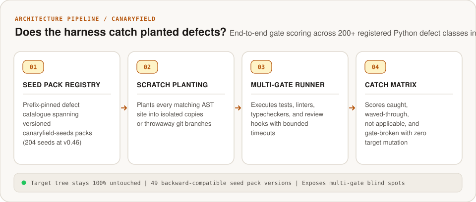
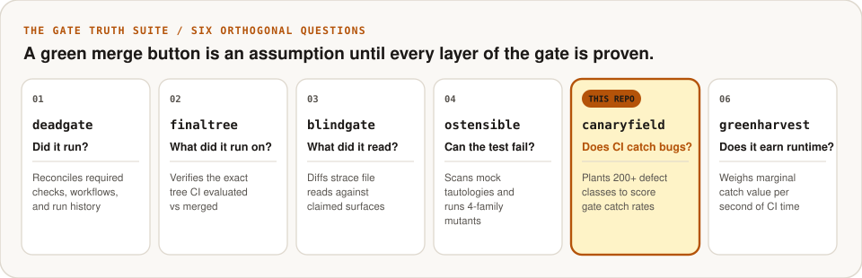

# Canaryfield Architecture

Canaryfield asks whether an engineering harness catches real defect classes end-to-end. Implemented as a zero-dependency pure-Rust crate (`src/`), Canaryfield maintains a prefix-pinned registry of 200+ Python AST defect classes, plants every matching site into scratch copies or throwaway git branches without touching the live repository, and scores arbitrary CI gates.

  <picture>
    <source media="(prefers-color-scheme: dark)" srcset="https://raw.githubusercontent.com/david-engelmann/canaryfield/main/docs/media/how-it-works-dark.svg">
    
  </picture>

## Pipeline Stages

### 1. Prefix-Pinned Seed Registry and Pack Loader (`src/registry.rs`, `src/seedpack.rs`)

Every slice growing the registry appends four new Python defect classes while keeping all earlier seed identifiers, names, and defect classes immutable. At `v0.46.0` (Round 59), the registry holds `204` seeds (`seed-00` through `seed-203`) under format `"canaryfield-seeds/49"`, and `load_seed_pack` validates `canaryfield-seeds/1` (`12` seeds) through `canaryfield-seeds/49` (`204` seeds) against their exact prefix slice, refusing any count, ID, name, or `defect_class` drift while leaving `description` as human prose.

### 2. Pure-Rust Python AST Planter (`src/pyparse.rs`, `src/pyapply.rs`)

Canaryfield parses target `.py` files with its own pure-Rust Python 3.12 parser and plants each seed across **every matching AST shape inside every applicable file** (Slices 3 and 4). Unparseable files in the target tree are recorded cleanly in `unparseable_files` rather than aborting the sweep.

### 3. Scratch-Copy and Throwaway-Branch Engine (`src/engine.rs`)

- **`--plant copy` (default)** Creates an isolated temporary copy for baseline verification and for each applicable seed, preserving symlinks and executable permissions while snapshotting target bytes before and after the run to verify `"target_unchanged": true`.
- **`--plant git-branches`** Clones the target into a scratch git repository and plants each applicable seed onto its own throwaway branch (`canaryfield/seed-XX`) so branch-aware gates (such as `git diff origin/main` linters and review bots) face realistic commits.

### 4. Multi-Gate Catch Matrix (`src/report.rs`)

Before scoring plantings, Canaryfield runs each `--gate NAME=COMMAND` once on an unplanted copy to record `clean_exits[gate]`. When `clean_exits[gate]` is non-zero (including `-1` when killed at `--timeout`), its cell across applicable seeds short-circuits to `"gate-broken"` without re-running the broken gate. When `clean_exits[gate]` is `0`, a planted run killed at `--timeout` scores `"timed-out"` with `planted_exits[gate]` set to `-1` rather than fabricating a catch, any other non-zero exit scores `"caught"`, and exit `0` scores `"waved-through"`.

  <picture>
    <source media="(prefers-color-scheme: dark)" srcset="https://raw.githubusercontent.com/david-engelmann/canaryfield/main/docs/media/gate-truth-arc-dark.svg">
    
  </picture>

