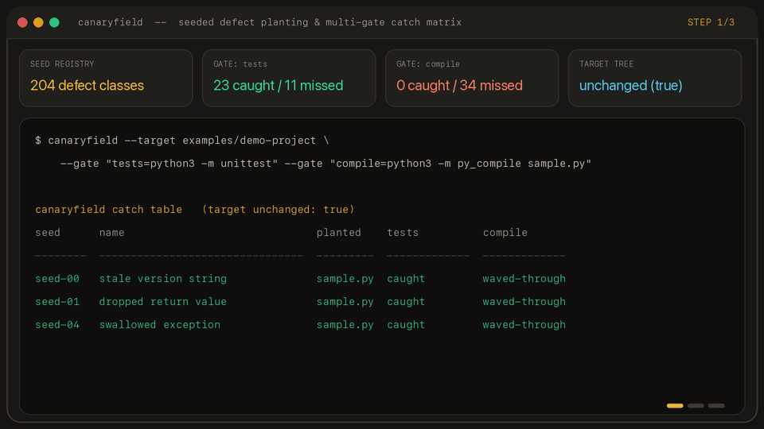
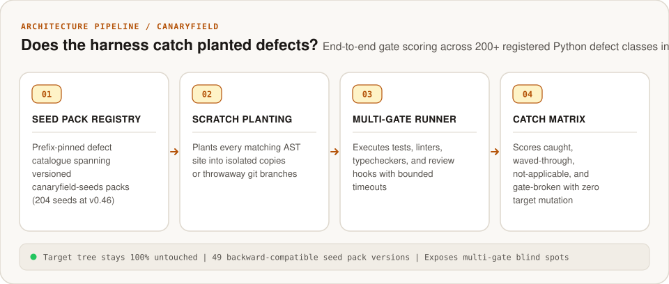
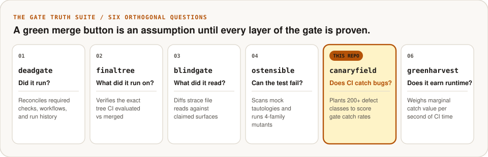

<p align="center">
  <a href="https://github.com/david-engelmann/canaryfield">
    <picture>
      <source media="(prefers-color-scheme: dark)" srcset="https://raw.githubusercontent.com/david-engelmann/canaryfield/main/docs/media/canaryfield-lockup-dark.svg">
      
    </picture>
  </a>
</p>

<h3 align="center">Plant 200+ real defect classes into scratch copies and score which CI gates catch each one.</h3>

<p align="center">A gate's catch rate is usually an assumption because nothing continuously sends known bad changes through your pipeline to check whether CI refuses them. <code>canaryfield</code> plants defects from a 200+ seed Python defect registry into isolated scratch copies or throwaway git branches, runs tests, linters, typecheckers, and review hooks side by side, and scores every gate catch and every blind spot.</p>

<p align="center">
  <a href="https://github.com/david-engelmann/canaryfield/blob/main/docs/GUIDE.md"><b>Operator Guide</b></a> |
  <a href="https://david-engelmann.github.io/canaryfield/">Published Docs</a> |
  <a href="https://github.com/david-engelmann/canaryfield/tree/main/examples">Examples</a> |
  <a href="https://github.com/david-engelmann/canaryfield/blob/main/docs/ARCHITECTURE.md">Architecture</a> |
  <a href="https://github.com/david-engelmann/canaryfield/blob/main/docs/FORMATS.md">Wire Formats</a> |
  <a href="https://github.com/david-engelmann/canaryfield/blob/main/docs/COMPARISON.md">Comparison</a> |
  <a href="https://github.com/david-engelmann/canaryfield/blob/main/docs/FAQ.md">FAQ</a> |
  <a href="https://github.com/david-engelmann/canaryfield/releases">Releases</a>
</p>

<p align="center">
  <a href="https://github.com/david-engelmann/canaryfield/actions/workflows/ci.yml"></a>
  <a href="https://david-engelmann.github.io/canaryfield/"></a>
  <a href="https://github.com/david-engelmann/canaryfield/blob/main/Cargo.toml"></a>
  <a href="https://github.com/david-engelmann/canaryfield/blob/main/LICENSE"></a>
</p>

<p align="center">
  
</p>

<p align="center"><sub>Every terminal line above comes from running the canaryfield release binary against examples/demo-project.</sub></p>

## What this is

A gate's catch rate is usually an assumption, because nothing continuously plants known bad changes to test the harness end to end. Canaryfield plants defects drawn from real defect classes as throwaway branches, runs them through the real CI, and records per gate which seeds were caught and which sailed past. The field covers the whole gate layer at once, tests, hooks, and review bots included. Over time it builds the bad change corpus that unique catches, overlap, and enforcement integrity all depend on. The boundary with its siblings is one sentence. Ostensible asks whether a test can fail, canaryfield asks whether the harness catches planted defects, greenharvest asks which tests earn their runtime.

<p align="center">
  <picture>
    <source media="(prefers-color-scheme: dark)" srcset="https://raw.githubusercontent.com/david-engelmann/canaryfield/main/docs/media/how-it-works-dark.svg">
    
  </picture>
</p>

## Install

Install from source with Cargo (Rust 1.80 or newer) or via `cargo-binstall` and the checksum-verifying installer script on Linux and macOS (`x86_64` and `aarch64`) for releases carrying prebuilt archives (`v0.46.0` once release archives are attached and `v0.47.0` onward).

```sh
cargo install --git https://github.com/david-engelmann/canaryfield --locked
```

```sh
curl -fsSL https://raw.githubusercontent.com/david-engelmann/canaryfield/main/install.sh | sh
export PATH="$HOME/.local/bin:$PATH"
cargo binstall --git https://github.com/david-engelmann/canaryfield canaryfield
```

## Quickstart

Clone this repository and score two gates side-by-side (`tests` vs `compile`) over the synthetic `examples/demo-project` target while leaving `examples/demo-project` untouched.

```sh
git clone https://github.com/david-engelmann/canaryfield.git
cd canaryfield
canaryfield \
  --target examples/demo-project \
  --gate "tests=python3 -m unittest" \
  --gate "compile=python3 -m py_compile sample.py" \
  --timeout 10
```

Eight representative rows from `examples/two-gates/catch-table.txt` (`204` seeds at `v0.46.0`) are shown below alongside the full summary counts.

```
canaryfield catch table
=======================

target           examples/demo-project
target unchanged true
clean exit for gate tests is 0
clean exit for gate compile is 0

seed      name                                     planted file  tests          compile
--------  ---------------------------------------  ------------  -------------  -------------
seed-00   stale version string                     sample.py     caught         waved-through
seed-04   swallowed exception                      sample.py     caught         waved-through
seed-07   dropped call argument                    sample.py     waved-through  waved-through
seed-16   widened exception handler                sample.py     waved-through  waved-through
seed-28   swapped raised error                     sample.py     caught         waved-through
seed-77   dropped parameter default                sample.py     waved-through  waved-through
seed-119  dropped exception type                   sample.py     waved-through  waved-through
seed-190  dropped last return value list element   sample.py     waved-through  waved-through

summary per gate
  tests    caught 23  waved-through 11  not-applicable 170  gate-broken 0
  compile  caught 0   waved-through 34  not-applicable 170  gate-broken 0
```

Export the versioned seed pack with `canaryfield --write-seed-pack seed-pack.json`, switch to throwaway branch planting with `--plant git-branches`, or emit sorted-key JSON with `--json`.

## Benchmarks and Verification

Run the full local gate from a clean checkout.

```sh
cargo test --locked
cargo fmt --check
cargo clippy --offline --all-targets
cargo package --locked
```

Measured with the `--release` binary over synthetic workloads.

| Workload | Input shape | Mean elapsed |
| --- | --- | --- |
| `--write-seed-pack` | Serialize `canaryfield-seeds` registry pack JSON | `27.0 ms` |
| `examples/demo-project` full-registry sweep | Parse AST, plant 34 applicable defect copies, verify `target_unchanged`, score fast gate | `4.79 s` |

## The Gate Truth Suite

<p align="center">
  <picture>
    <source media="(prefers-color-scheme: dark)" srcset="https://raw.githubusercontent.com/david-engelmann/canaryfield/main/docs/media/gate-truth-arc-dark.svg">
    
  </picture>
</p>

| Tool | Question answered | Primary evidence |
| --- | --- | --- |
| [deadgate](https://github.com/david-engelmann/deadgate) | Did the required check actually run? | Branch protection, workflow YAML, and job history |
| [finaltree](https://github.com/david-engelmann/finaltree) | What tree did CI actually evaluate? | Commit and tree lineage across merge queues |
| [blindgate](https://github.com/david-engelmann/blindgate) | What files did the gate actually read? | Linux `strace` descriptor and path reconstruction |
| [ostensible](https://github.com/david-engelmann/ostensible) | Can the test actually fail? | Static tautology scan and 4-family `pytest` mutants |
| [canaryfield](https://github.com/david-engelmann/canaryfield) | Does the harness catch planted defects? | 200+ seeded Python defect classes across real gates |
| [greenharvest](https://github.com/david-engelmann/greenharvest) | Which tests earn their CI runtime? | Marginal defect-catch value per second of execution |

## Documentation

| If you want to... | Read |
| --- | --- |
| Browse the searchable handbook with diagrams | [Published documentation](https://david-engelmann.github.io/canaryfield/) |
| Install, configure CI workflows, and run day-two operations | [Operator Guide](https://github.com/david-engelmann/canaryfield/blob/main/docs/GUIDE.md) |
| Understand parser bounds, engine phases, and containment invariants | [Architecture](https://github.com/david-engelmann/canaryfield/blob/main/docs/ARCHITECTURE.md) |
| Integrate JSON or text schemas into downstream tooling | [Wire Formats](https://github.com/david-engelmann/canaryfield/blob/main/docs/FORMATS.md) |
| Compare `canaryfield` against existing linters, coverage, and mutators | [Comparison](https://github.com/david-engelmann/canaryfield/blob/main/docs/COMPARISON.md) and [FAQ](https://github.com/david-engelmann/canaryfield/blob/main/docs/FAQ.md) |
| Review threat boundaries, vulnerability reporting, and contribution gates | [Security Policy](https://github.com/david-engelmann/canaryfield/blob/main/SECURITY.md) and [Contributing](https://github.com/david-engelmann/canaryfield/blob/main/CONTRIBUTING.md) |
